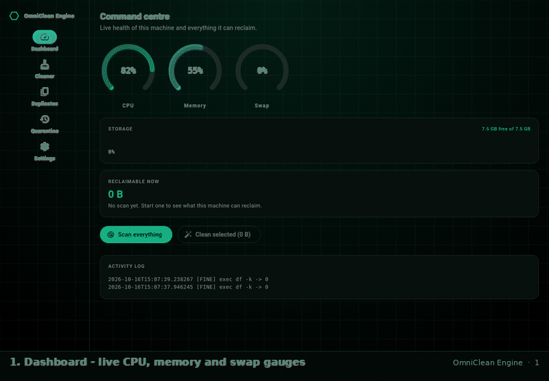
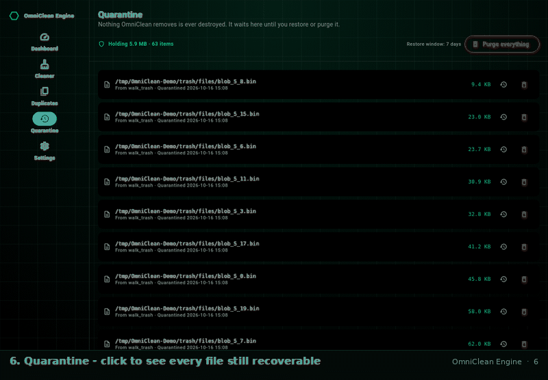
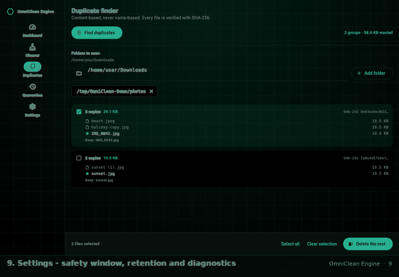
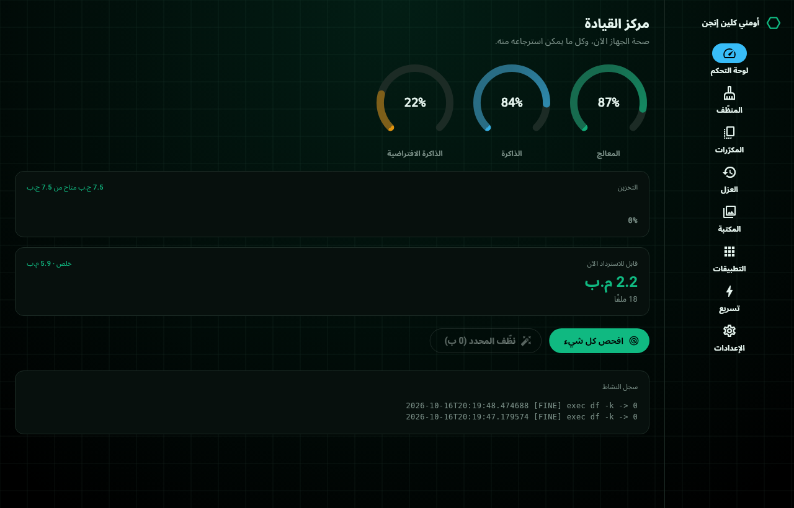
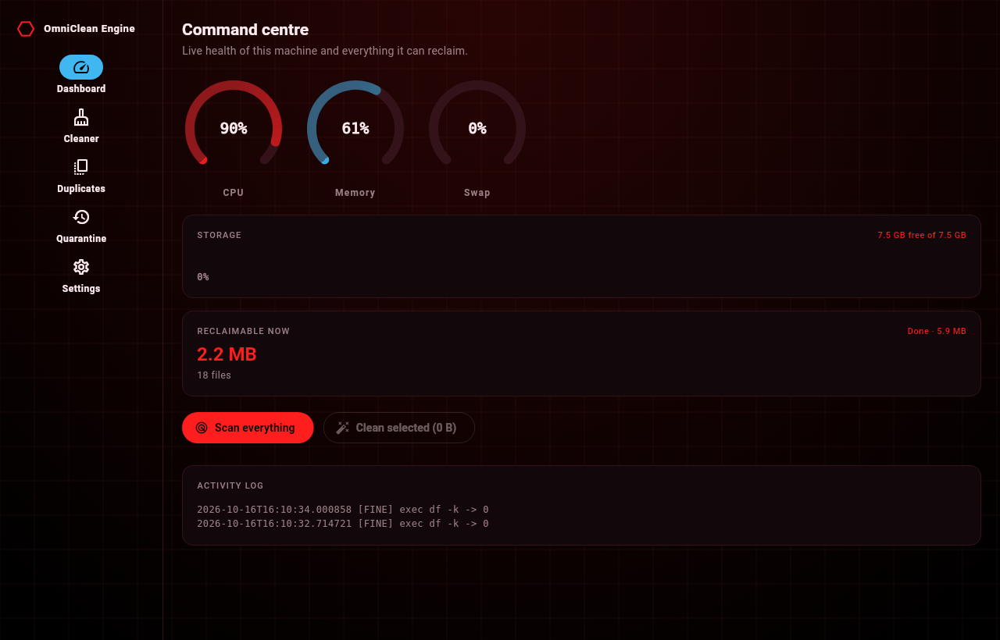
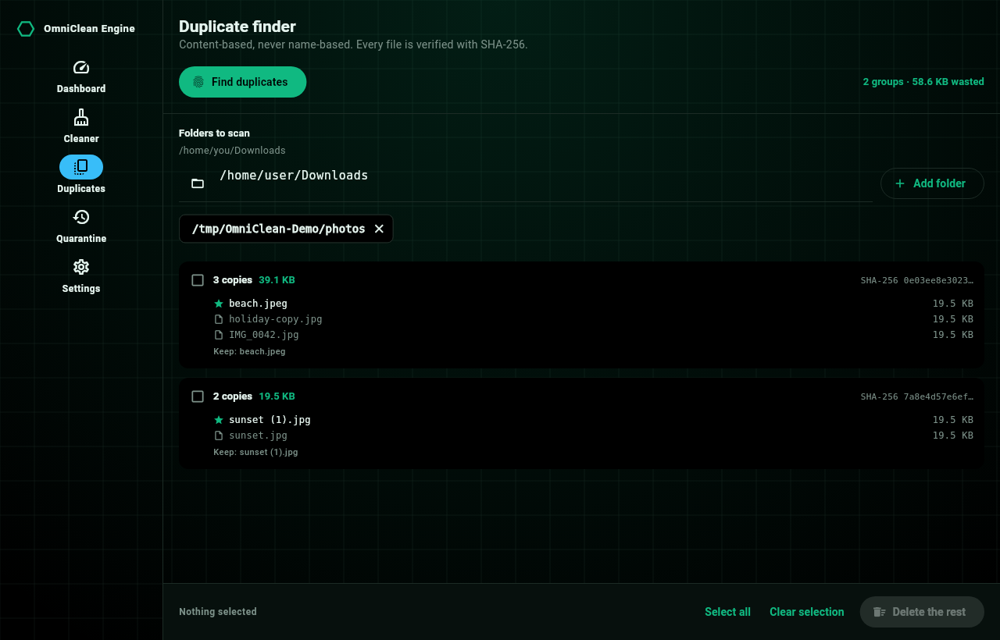

<div align="center">

# OmniClean Engine


### The cross-platform cleaner that is **structurally incapable** of deleting something important.

**Windows · Linux (Kali / Debian) · Android** — one codebase, one safety model,
two languages.

[](https://github.com/aihams21/OmniClean-Engine/actions/workflows/ci.yml)
[](https://github.com/aihams21/OmniClean-Engine/releases/latest)
[](LICENSE)
[](https://flutter.dev)
[](https://dart.dev)
[](https://github.com/aihams21/OmniClean-Engine/actions)
[](LICENSE)

**[English](#english) · [العربية](#arabic)**

</div>

---

## Why this exists

Every "system cleaner" on every platform makes the same promise and then breaks
it. They show you a number, they delete something, and the number was a guess.
OmniClean Engine is built around refusing to do that:

> **Nothing is ever deleted. Everything is *moved*, and stays restorable for
> seven days.**

That is not a setting. It is the architecture — see [the safety model](#the-safety-model).

---

## Walkthrough

Silent, cursor-driven, captured from the **real application** by
`test/walkthrough_test.dart` — every byte and every percentage on screen is a
genuine measurement from the machine that rendered it.

### 1 — Dashboard and cleaner



Live CPU / memory / swap gauges · storage bar · *how much can I actually get
back* · scan every module → review the list → confirm → done.

### 2 — Quarantine and duplicate finder



Every removed file, one click from being restored. Duplicate finder groups files
by **SHA-256 content**, never by name, and always keeps the oldest original.

### 3 — Settings, both themes, Arabic



Switch the accent, switch the language (full RTL), set the minimum age, set the
retention window, read the log.

---

## Download

<table>
<tr><th>Platform</th><th>Beginner</th><th>Professional</th></tr>
<tr>
<td><strong>Linux</strong></td>
<td><a href="https://github.com/aihams21/OmniClean-Engine/releases/latest"></a><br>No install, no root, runs anywhere</td>
<td><a href="https://github.com/aihams21/OmniClean-Engine/releases/latest"></a> <a href="https://github.com/aihams21/OmniClean-Engine/releases/latest"></a></td>
</tr>
<tr>
<td><strong>Windows</strong></td>
<td><a href="https://github.com/aihams21/OmniClean-Engine/releases/latest"></a><br>Wizard, Start-menu entry, desktop shortcut</td>
<td><a href="https://github.com/aihams21/OmniClean-Engine/releases/latest"></a> · <code>omni_clean_engine.exe</code></td>
</tr>
<tr>
<td><strong>Android</strong></td>
<td><a href="https://github.com/aihams21/OmniClean-Engine/releases/latest"></a><br>Allow unknown sources, done</td>
<td><a href="https://github.com/aihams21/OmniClean-Engine/releases/latest"></a> · <code>.apk</code> per ABI</td>
</tr>
</table>

**Just want one file?** Grab the latest release and pick the single asset that
matches your platform. Every release is signed and checksummed.

```bash
# Linux, the easy way
wget https://github.com/aihams21/OmniClean-Engine/releases/latest/download/omniclean-engine_1.0.0_amd64.AppImage
chmod +x omniclean-engine_1.0.0_amd64.AppImage
./omniclean-engine_1.0.0_amd64.AppImage
```

---

## The safety model

This is the part that matters, so it is first in the code and first in this
document.

```
      scan                    gate                      move                 restore
  ────────────▶  ProtectedPaths  ──▶  allowedRoots  ──▶  Quarantine  ──────────────▶  original path
                 + minAge + type       containment        + manifest JSON
```

### 1. It never unlinks

Everything OmniClean removes is *moved* into a quarantine directory under your
user data folder, alongside a JSON manifest recording the original path, the
size, the module that claimed it and the timestamp. Uninstallation of the app
never touches your data; a mistaken cleanup is a single click.

### 2. Three independent gates, applied per path

| Gate | Refuses |
|---|---|
| `ProtectedPaths` | Credentials, config, VCS history and databases — by structure and by extension, never by substring |
| `allowedRoots` | Anything outside the roots the module itself declared |
| `type / mtime` | Symlinks (never followed), missing paths, and anything younger than `minAge` |

`ProtectedPaths` refuses `/home/you/.ssh/anything` and
`~/.config/whatever`, plus **every** file ending in `.db`, `.sqlite`, `.key`,
`.pem`, `.wallet`, `.crt` — on all three platforms. A false positive only costs
you a skipped file. A false negative can cost you your work history.

### 3. Symlinks are never followed

A link is counted and skipped. This one rule is what stops
`~/.cache/thing → /` from becoming a very bad afternoon.

### 4. Privileges are visible, never assumed

Modules that need root are **marked in the UI before you tap them**, and
escalation goes through `pkexec` / non-interactive `sudo`. If no privileged
helper exists, the module says so instead of pretending it ran.

### 5. Honest numbers

- *Reclaimable now* — passed every gate, can be moved immediately.
- *Held back* — exists, but a protection rule or the age gate is holding it.
- Gauges show **unavailable**, never a fabricated `0 %`, when the kernel gives
  nothing to read.
- The RAM figure is kernel-available memory, not a guess.

Read the full reasoning in **[SECURITY.md](SECURITY.md)**.

---

## What it actually cleans

Every target declares its roots, its risk level, whether it needs privileges and
how young a file must be before it may be touched.

### Linux — 10 modules

| Module | Roots | Risk |
|---|---|---|
| APT package cache | `/var/cache/apt/archives` | Elevated · root |
| APT package lists | `/var/lib/apt/lists` | Elevated · root |
| System journal | `/var/log/journal`, `/run/log/journal` | Elevated · root |
| Crash reports | `/var/crash` | Elevated |
| Temporary files | `/tmp`, `/var/tmp` | Moderate |
| User cache | `~/.cache` | Safe |
| User journal | `$XDG_DATA_HOME/systemd/journal` | Safe |
| Trash | per-user trash directories | Safe |
| Flatpak cache | `~/.cache/flatpak` | Safe |
| Thumbnails | `~/.cache/thumbnails` | Safe |

Plus `apt-get autoremove`, simulated first and shown to you before anything is
removed.

### Windows — 12 modules

`%TEMP%` and `%LOCALAPPDATA%\Temp` · `C:\Windows\Temp` · Edge / Chrome / Firefox
caches · Event logs · Windows Error Reporting · Minidumps · Windows Update
download cache · Delivery Optimization · pending driver installs (`inf/pending`)
· Setup logs (`panther`).

> `C:\Windows` itself is protected. Only the ten temp-and-log paths above it are
> reachable, and they are listed explicitly in the source.

### Android — 5 modules

App cache (root path when a root helper exists, scoped storage otherwise) ·
self cache · junk in Downloads (`.part`, `.crdownload`, `.opdownload`,
`.tmp`, obsolete APKs) · leftover OBB directories · MediaStore thumbnails.

---

## Duplicate finder — content, never names

Three passes, and the first two do the heavy lifting for free:

1. **Size bucket** — files of different sizes cannot be duplicates.
2. **Partial hash** — head + tail window + size, to discard the easy 99 %.
3. **Full SHA-256** — the only thing that decides.

The SHA-256 work is fanned out across `Isolate.run` with a budget derived from
your core count, so it actually uses the machine. The oldest copy in each group
is marked as the one to keep, and a review list lets you choose per group before
anything moves. Progress and cancellation are live.

---

## Interface

- **Cyberpunk dark theme** on Void Black `#000000`, with a real accent system.
- **Two accents, switchable instantly and persisted**: Cyber Green `#10B981`
  and Deep Crimson `#FF1E1E` — crimson is also what every warning and every
  dangerous action uses.
- **Custom-painted gauges** (`ArcGauge`), storage bar, and a grid-and-scanline
  background.
- **Navigation adapts**: a rail on desktop, a bottom bar on a phone — built
  from one list so a screen can never exist in one layout and be missing from
  the other.
- **Fully localized English and Arabic (RTL)**, hand-written, not machine
  translated. 188 keys, zero untranslated strings.





---

## Architecture

```
lib/
├── main.dart                  ensureInitialized → window → bootstrap → runApp
├── bootstrap.dart             resolveLocale, OmniCleanRuntime, OmniCleanApp
├── core/
│   ├── safety/                protected_paths · quarantine · safe_delete
│   └── util/                  byte_fmt (en + ar units) · ring-buffer logger
├── engine/
│   ├── shell.dart             escalation (pkexec / sudo -n), subprocess, du
│   ├── cleaners/              clean_target · directory_sweeper · apt_parsers
│   │                          linux_cleaner · windows_cleaner · android_cleaner
│   ├── duplicates/            hasher (SHA-256) · duplicate_finder (3-pass)
│   └── metrics/               parsers (/proc, df) · system_snapshot
│                              windows_metrics (PowerShell) · collector
└── ui/
    ├── theme/                 CyberPalette, both accents, script-aware tracking
    ├── l10n/                  app_en.arb · app_ar.arb → generated
    ├── widgets/               CyberBackground · ArcGauge · StorageBar · ModuleTile
    ├── controllers/           ChangeNotifier: settings · cleaner · duplicates ·
    │                          quarantine — each fully injectable for tests
    └── screens/               AppShell + dashboard/cleaner/duplicates/
                               quarantine/settings
```

Dependencies are deliberately boring: `crypto` for hashing, `path_provider`,
`shared_preferences`, `window_manager`, `intl`, `flutter_localizations`. No
telemetry, no analytics, no network client in the shipped app.

| | |
|---|---|
| Dart source (excluding generated l10n) | 7 669 lines · 37 files |
| Dart source + tests | 14 839 lines |
| Automated tests | **248 passing**, 1 skipped |
| ARB translation keys | 188 per language |
| Clean targets | 10 Linux · 12 Windows · 5 Android |

---

## Building it yourself

```bash
git clone https://github.com/aihams21/OmniClean-Engine.git
cd OmniClean-Engine
flutter pub get
flutter test

# Linux (needs clang cmake ninja-build pkg-config libgtk-3-dev liblzma-dev)
flutter build linux --release
python3 tool/packaging/linux_packaging.py all    # .deb + .AppImage + .tar.gz

# Windows
flutter build windows --release
# then compile the installer:
#   iscc windows/runner/installer/omniclean.iss

# Android
flutter build apk --release --split-per-abi
flutter build appbundle --release
```

Release signing for Android reads four values from `android/key.properties`
or from the environment (`OMNICLEAN_KEYSTORE_PATH`,
`OMNICLEAN_KEYSTORE_PASSWORD`, `OMNICLEAN_KEY_ALIAS`, `OMNICLEAN_KEY_PASSWORD`).
**No key is ever committed** — the `security` CI job fails the build if a
keystore is ever tracked. With no keystore configured, a release build is
produced unsigned rather than debug-signed, on purpose.

### Regenerating the walkthrough

```bash
flutter test test/walkthrough_test.dart   # real app → docs/walkthrough/frames/*.png
python3 tool/build_walkthrough_gifs.py   # → docs/walkthrough/*.gif
```

---

## Contributing

Read **[CONTRIBUTING.md](CONTRIBUTING.md)** — especially the rules about tests
first, and about never hard-coding a user-visible string.

Found something that should not have been deletable? Do not open a public issue.
Use **[SECURITY.md](SECURITY.md)**.

---

<a name="english"></a>

## English

OmniClean Engine is a cross-platform cleaner and accelerator for **Windows**,
**Linux (Kali / Debian)** and **Android**, written in Flutter.

Its defining property is that it **never deletes**. Every file it removes is
moved into a per-user quarantine with a JSON manifest and can be restored with a
single click for seven days. Three independent gates — a structural deny-list,
a declared-roots check and a minimum-age check — are re-applied to every
individual path, and symlinks are never followed.

The duplicate finder groups files by **SHA-256 content**, never by filename,
using a three-pass strategy (size, partial hash, full hash) fanned out across
isolates. Elevated modules are marked before you run them and escalate through
`pkexec` or non-interactive `sudo`.

The interface is a cyberpunk dark theme on Void Black with two switchable
accents — Cyber Green and Deep Crimson — real-time CPU, memory and swap gauges,
and complete English and Arabic (RTL) localization.

MIT licensed. No telemetry, no analytics, no network code in the shipped app.

---

<a name="arabic"></a>

## العربية

**أومني كلين إنجن** منظّف ومسرّع نظام يعمل على **ويندوز** و**لينكس (كالي / دبيان)** و**أندرويد**، مبني بـ Flutter.

**خاصيته اللي بتميّزه:** ما بيحذف. كل ملف بينظفه بيننقل إلى مجلد عزل (Quarantine)
بح manifest بصيغة JSON، وبتقدر ترجّعه بضغطة وحدة خلال سبعة أيام. تلات بوّابات
مستقلة—قائمة منع بنيوية، وفحص الجذور المصرّح بها، وفحص عمر الملف—بينطبّق على
**كل مسار لحاله**، والروابط الرمزية (symlinks) ما بينتبَع أبداً.

**كاشف المكرّرات** بيجمّع الملفات حسب **محتوى SHA-256**، مش حسب اسم الملف،
بثلاث مراحل (الحجم، ثم هاش جزئي، ثم هاش كامل) موزّعة على عدة أنوية. والمجموعات
اللي بتحتاج صلاحيات مدير بتظهرلك **قبل** ما تضغط، والتصعيد بيصير عبر `pkexec`
أو `sudo` بلا ما يعلق على سؤال.

**الواجهة** ثيم داكن سيبرpunk على أسود `#000000`، بلونين بتبدّل بينهم فوراً:
أخضر سيبر `#10B981` وأحمر قرمزي `#FF1E1E`، مع مقاييس حيّة للمعالج والذاكرة
والذاكرة الافتراضية، ودعم كامل للعربية (RTL) والإنجليزية.

رخصة MIT. بدون تتبّع، وبدون أي تحليلات، وبدون اتصال بالشبكة.

---

## License

[MIT](LICENSE) © 2026 Aiham Al-Haj ([@aihams21](https://github.com/aihams21))
